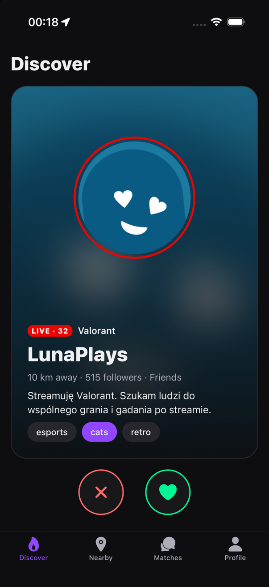
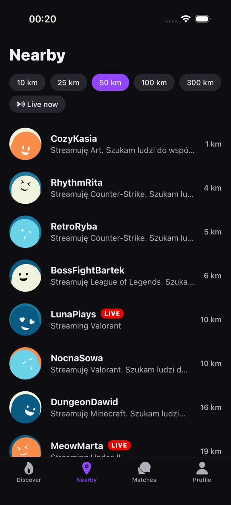
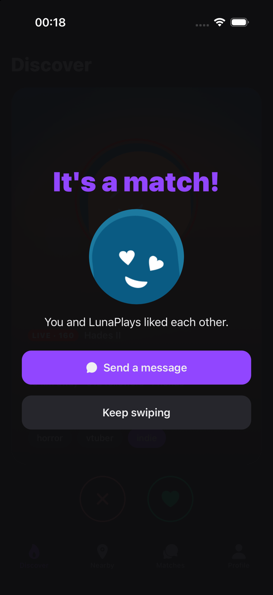
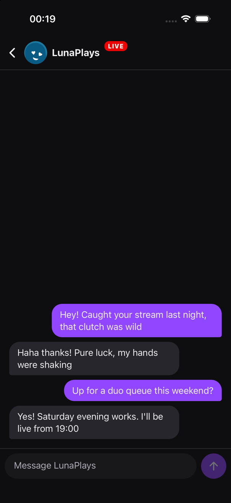

# StreamMatch

A Tinder-style app for Twitch streamers: sign in with Twitch, swipe on other
streamers, find the ones near you, match and chat in real time.

A from-scratch rewrite of [Tinder_Twitch](https://github.com/JakubJakubiak/Tinder_Twitch)
(React Native 0.73 + Firebase), which is kept as the legacy version.

<p>
  
  
  
  
</p>

Full documentation with screenshots and diagrams (in Polish): [docs/README.md](docs/README.md).

## Stack

- **App:** React Native 0.86 with native `ios/` and `android/` projects, Expo Router, Reanimated 4
- **Backend:** [Convex](https://www.convex.dev) — database, realtime queries, cron jobs
- **Auth:** [Convex Auth](https://labs.convex.dev/auth) with Twitch OAuth (no Firebase, no separate auth server)

## Features

- Twitch login; avatar, bio, follower count and live status pulled from the Twitch API
- Swipe deck ordered by live status, shared interests and distance
- **Nearby**: streamers within 10–300 km, with a "live now" filter
- Mutual likes create a match; realtime chat with unread badges
- Profile: bio, intent (friends / collabs / dating), interests, distance, visibility
- Safety: 18+ confirmation, block, report, unmatch, full account deletion
- Location is rounded to ~1 km before it is stored, and other users only ever see a distance

## Setup

```bash
npm install
npx convex dev            # log in, create a project, writes .env.local; keep it running
npx @convex-dev/auth      # generates JWT keys and sets SITE_URL (use http://localhost:8081)
npm start                 # Metro bundler, in a second terminal
```

### Native builds

The app is built from the native projects in `ios/` and `android/` — no Expo Go
and no EAS. Expo libraries are used only as ordinary npm packages.

**iOS** (Xcode + CocoaPods):

```bash
cd ios && LANG=en_US.UTF-8 pod install && cd ..
open ios/StreamMatch.xcworkspace     # then Run in Xcode
# or from the terminal:
npm run ios
```

**Android** (Android Studio, or Gradle directly):

```bash
export JAVA_HOME="/Applications/Android Studio.app/Contents/jbr/Contents/Home"
export ANDROID_HOME="$HOME/Library/Android/sdk"
npm run android                      # or: cd android && ./gradlew assembleDebug
```

Debug builds load JavaScript from Metro (`npm start`). After changing
`app.json` (name, icons, permissions, plugins) regenerate the native projects
with `npx expo prebuild`.

### Twitch login

1. Create an application at <https://dev.twitch.tv/console/apps>.
2. Add this OAuth redirect URL (your deployment name is in `.env.local`):
   `https://<your-deployment>.convex.site/api/auth/callback/twitch`
3. Give Convex the credentials:

```bash
npx convex env set AUTH_TWITCH_ID <client id>
npx convex env set AUTH_TWITCH_SECRET <client secret>
```

### Trying it without Twitch

```bash
npx convex env set DEMO_LOGIN true                        # adds a "Try a demo account" button
npx convex run seed:run '{"lat": 52.23, "lng": 21.01}'    # 20 fake streamers around that point
npx convex run seed:demoChat                              # scripted conversation in demo matches
```

Run the seed again after signing in: half of the fake streamers then like you
back, so swiping right on them produces matches. Never set `DEMO_LOGIN` on a
production deployment.

## Layout

```
convex/            backend
  schema.ts        tables and indexes
  auth.ts          Twitch provider, profile creation on first sign-in
  discover.ts      swipe deck and nearby search (1° grid cells + haversine)
  swipes.ts        likes, passes and match creation
  matches.ts       match list, unread state, unmatch
  messages.ts      chat
  twitch.ts        Twitch API sync and the live-status cron
  safety.ts        block and report
  seed.ts          demo data
src/app/           screens (Expo Router)
src/components/    swipe card, profile card, shared UI
```

## Docs

- [Documentation](docs/README.md) — screens, architecture, data model, configuration (in Polish)
- [How nearby search works](docs/szukanie-w-okolicy.md) (in Polish)

## Checks

```bash
npx tsc --noEmit
npx expo lint
```
