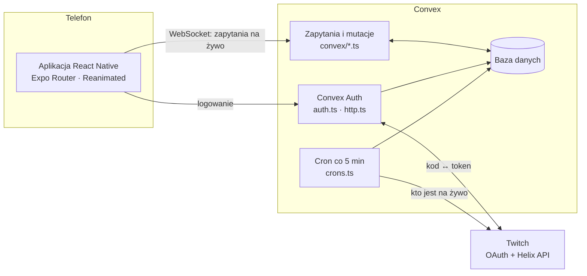
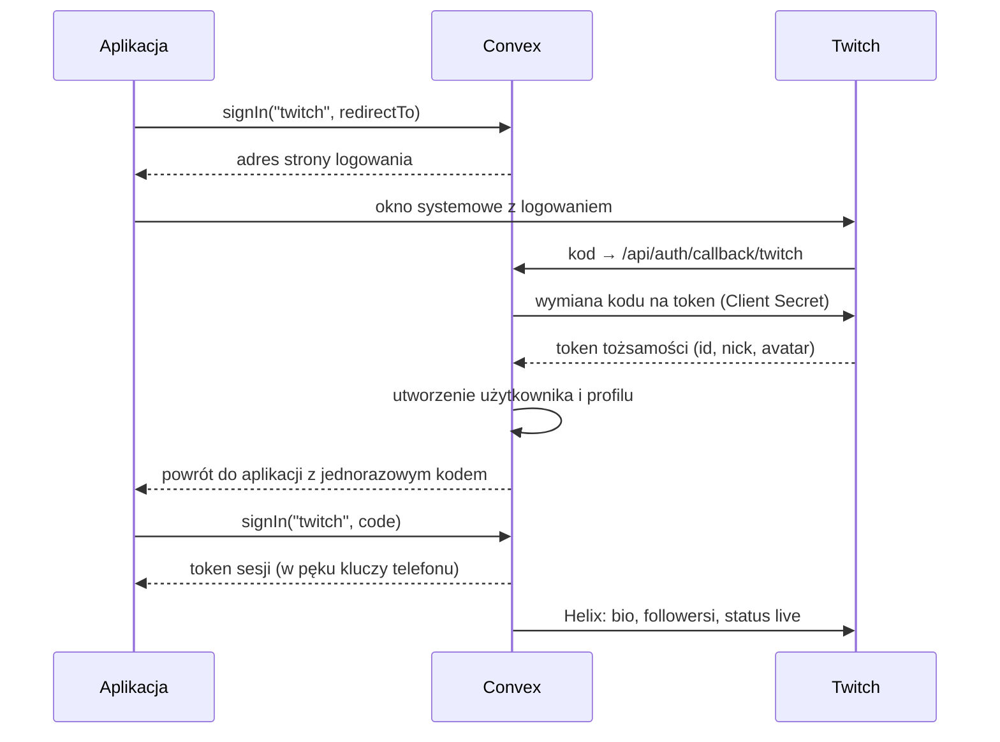
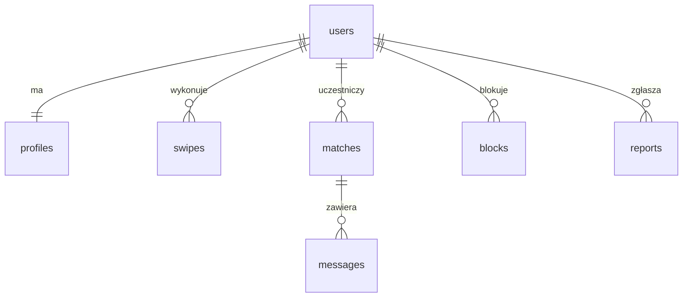

# StreamMatch — dokumentacja

Aplikacja typu Tinder dla streamerów z Twitcha: logowanie kontem Twitch, przesuwanie profili,
szukanie streamerów w okolicy, dopasowania i czat na żywo.

- [Ekrany](#ekrany)
- [Architektura](#architektura)
- [Logowanie przez Twitch](#logowanie-przez-twitch)
- [Model danych](#model-danych)
- [Funkcje backendu](#funkcje-backendu)
- [Konfiguracja](#konfiguracja)
- [Budowanie i uruchamianie](#budowanie-i-uruchamianie)
- [Dane testowe](#dane-testowe)
- [Bezpieczeństwo i prywatność](#bezpieczeństwo-i-prywatność)
- [Znane braki](#znane-braki)
- Osobno: [Szukanie streamerów w okolicy](szukanie-w-okolicy.md)

## Ekrany

Zrzuty z natywnej aplikacji iOS (symulator iPhone 17), na danych testowych.

### Logowanie i start

| Ekran startowy | Logowanie Twitch | Onboarding |
|:-:|:-:|:-:|
|  |  |  |
| `src/app/sign-in.tsx` | strona Twitcha w oknie systemowym | `src/app/onboarding.tsx` |

- **Ekran startowy** — jeden przycisk „Continue with Twitch". Gdy serwer nie ma kluczy Twitcha,
  przycisk jest wyszarzony i pojawia się komunikat.
- **Logowanie Twitch** — otwiera się w bezpiecznym oknie systemowym; aplikacja nigdy nie widzi hasła.
- **Onboarding** — bio (domyślnie pobrane z Twitcha), cel (znajomi / collaby / randki),
  do 8 zainteresowań, opcjonalne udostępnienie lokalizacji i obowiązkowe potwierdzenie 18+.

### Poznawanie ludzi

| Discover | Dopasowanie | Profil streamera |
|:-:|:-:|:-:|
|  |  |  |
| `src/app/(tabs)/index.tsx` | okno w `index.tsx` | `src/app/user/[userId].tsx` |

- **Discover** — talia kart. Przesunięcie w prawo lub zielone serce = polubienie, w lewo lub
  czerwony krzyżyk = pominięcie. Kolejność: najpierw osoby na żywo, potem wspólne zainteresowania
  (podświetlone na fioletowo), potem odległość. Czerwona obwódka i plakietka `LIVE` oznaczają
  trwający stream z liczbą widzów i grą.
- **Dopasowanie** — pojawia się, gdy obie strony się polubiły. Można od razu napisać.
- **Profil streamera** — po dotknięciu karty lub wiersza listy: pełne bio, tytuł streama,
  przycisk do kanału na Twitchu, blokowanie i zgłaszanie.

### W okolicy, rozmowy, ustawienia

| Nearby | Matches | Czat | Profil |
|:-:|:-:|:-:|:-:|
|  |  |  |  |
| `(tabs)/nearby.tsx` | `(tabs)/matches.tsx` | `chat/[matchId].tsx` | `(tabs)/profile.tsx` |

- **Nearby** — streamerzy w promieniu 10–300 km, od najbliższego, z filtrem „Live now".
  Jak to działa: [szukanie-w-okolicy.md](szukanie-w-okolicy.md).
- **Matches** — lista dopasowań z ostatnią wiadomością; nieprzeczytane są pogrubione z kropką,
  a ich liczba widnieje na ikonie zakładki.
- **Czat** — wiadomości pojawiają się natychmiast u obu stron, bez odświeżania.
- **Profil** — edycja bio, celu i zainteresowań, maksymalny dystans, przełącznik lokalizacji,
  ukrycie profilu, wylogowanie i trwałe usunięcie konta.

## Architektura



- **Aplikacja** — React Native 0.86 z natywnymi projektami `ios/` i `android/`. Biblioteki Expo
  (router, lokalizacja, obrazy, pęk kluczy) są używane jako zwykłe paczki; budowanie idzie przez
  Xcode i Gradle, bez Expo Go i EAS.
- **Convex** — jedyny serwer. Trzyma bazę, logikę i logowanie. Zapytania są „żywe": gdy dane się
  zmienią, ekran odświeża się sam (stąd czat i lista dopasowań bez odpytywania).
- **Twitch** — tożsamość użytkownika oraz publiczne dane kanału.

Nie ma Firebase ani osobnego serwera do logowania (stary endpoint na Vercelu nie jest używany).

## Logowanie przez Twitch



- Od Twitcha prosimy tylko o zakres `openid` — bez adresu e-mail.
- Client Secret leży wyłącznie w zmiennych środowiskowych Convex, nigdy w aplikacji.
- Bio, liczba followersów i status live są pobierane tokenem aplikacji (client credentials),
  więc tokeny użytkowników nie są nigdzie przechowywane.
- Po pierwszym logowaniu `afterUserCreatedOrUpdated` w `convex/auth.ts` tworzy profil i zleca
  `twitch.syncUser`.

## Model danych

Schemat: [`convex/schema.ts`](../convex/schema.ts).



| Tabela | Co trzyma | Najważniejsze pola |
|---|---|---|
| `users` | tożsamość (Convex Auth) | `name`, `image`, `twitchId` |
| `profiles` | profil w aplikacji | `login`, `displayName`, `bio`, `tags`, `intent`, `isLive`, `gameName`, `viewerCount`, `followerCount`, `lat`, `lng`, `cell`, `maxDistanceKm`, `discoverable`, `onboarded` |
| `swipes` | polubienia i pominięcia | `fromId`, `toId`, `liked` |
| `matches` | pary, które się polubiły | `userA` < `userB`, `lastMessageText`, `lastMessageAt`, `readAtA`, `readAtB` |
| `messages` | wiadomości czatu | `matchId`, `senderId`, `body` |
| `blocks` | blokady | `blockerId`, `blockedId` |
| `reports` | zgłoszenia | `reporterId`, `reportedId`, `reason` |
| `twitchAppTokens` | pamięć podręczna tokenu aplikacji Twitcha | `accessToken`, `expiresAt` |

Do tego tabele sesji z Convex Auth (`authAccounts`, `authSessions`, `authRefreshTokens` i inne).

Para w `matches` jest zawsze zapisana w tej samej kolejności (`userA` < `userB`), więc dwie osoby
mają dokładnie jeden wiersz.

## Funkcje backendu

| Plik | Funkcja | Co robi |
|---|---|---|
| `app.ts` | `config` | które metody logowania są włączone |
| `profiles.ts` | `me`, `get` | własny profil; cudzy profil (bez współrzędnych) |
| | `update` | bio, zainteresowania, cel, dystans, widoczność, potwierdzenie 18+ |
| | `setLocation`, `clearLocation` | zapis zaokrąglonej pozycji; jej usunięcie |
| | `deleteAccount` | usuwa profil, dopasowania, wiadomości, polubienia, blokady i sesje |
| `discover.ts` | `deck` | 20 kart do przesuwania |
| | `nearby` | do 60 streamerów w zadanym promieniu |
| `swipes.ts` | `swipe` | zapisuje polubienie/pominięcie; przy wzajemności tworzy dopasowanie |
| `matches.ts` | `list`, `unreadCount`, `get` | lista rozmów, licznik nieprzeczytanych, nagłówek czatu |
| | `unmatch` | usuwa dopasowanie i rozmowę |
| `messages.ts` | `list`, `send`, `markRead` | ostatnie 100 wiadomości, wysyłka (do 1000 znaków), oznaczenie jako przeczytane |
| `safety.ts` | `block`, `report` | blokada (usuwa też dopasowanie); zgłoszenie |
| `twitch.ts` | `syncUser` | pobiera dane kanału po logowaniu |
| | `refreshLive` | cron: status live dla do 1000 ostatnio aktywnych profili |
| `seed.ts` | `run`, `demoChat` | dane testowe |

Każda publiczna funkcja sprawdza zalogowanego użytkownika (`requireProfile` w `convex/lib.ts`),
a funkcje czatu dodatkowo to, czy należy on do danego dopasowania (`requireMatch`).

## Konfiguracja

Zmienne środowiskowe **Convex** (`npx convex env set NAZWA wartość`):

| Zmienna | Do czego | Skąd |
|---|---|---|
| `AUTH_TWITCH_ID` | Client ID aplikacji Twitch | dev.twitch.tv/console/apps |
| `AUTH_TWITCH_SECRET` | Client Secret | tamże, „New Secret" |
| `JWT_PRIVATE_KEY`, `JWKS` | podpisywanie tokenów sesji | `npx @convex-dev/auth` |
| `SITE_URL` | adres wersji web (powrót po logowaniu) | np. `http://localhost:8081` |
| `DEMO_LOGIN` | `true` włącza konta demo bez hasła — tylko do testów | ręcznie |

Plik `.env.local` w projekcie (tworzy go `npx convex dev`, nie trafia do gita):

| Zmienna | Do czego |
|---|---|
| `CONVEX_DEPLOYMENT` | na który deployment wgrywa `npx convex dev` |
| `EXPO_PUBLIC_CONVEX_URL` | adres backendu, z którym łączy się aplikacja |

W konsoli Twitcha musi być wpisany adres zwrotny:

```
https://<deployment>.convex.site/api/auth/callback/twitch
```

## Budowanie i uruchamianie

Potrzebne trzy procesy: backend, Metro i natywna aplikacja.

```bash
npx convex dev      # 1. backend: wgrywa funkcje przy każdym zapisie pliku
npm start           # 2. Metro: serwuje kod JavaScript aplikacji
npm run ios         # 3. build i start na symulatorze iOS
```

**iOS w Xcode:** `cd ios && LANG=en_US.UTF-8 pod install`, potem `open ios/StreamMatch.xcworkspace` i Run.

**Android:**

```bash
export JAVA_HOME="/Applications/Android Studio.app/Contents/jbr/Contents/Home"
export ANDROID_HOME="$HOME/Library/Android/sdk"
npm run android     # albo: cd android && ./gradlew assembleDebug
```

Po zmianie `app.json` (nazwa, ikona, uprawnienia) trzeba odtworzyć projekty natywne: `npx expo prebuild`.

Kontrola jakości: `npx tsc --noEmit` i `npx expo lint`.

## Dane testowe

```bash
npx convex run seed:run '{"lat": 52.23, "lng": 21.01}'   # 20 streamerów wokół punktu
npx convex run seed:demoChat                              # przykładowa rozmowa w dopasowaniach
```

- Seed można puszczać wielokrotnie — nie dubluje profili.
- Co drugi testowy streamer „lubi" każdego prawdziwego użytkownika, więc polubienie go od razu
  daje dopasowanie. Po założeniu nowego konta uruchom seed ponownie.
- Testowe profile mają `isDemo: true` i cron statusu live ich nie rusza.

## Bezpieczeństwo i prywatność

- **Lokalizacja** jest zaokrąglana do ok. 1 km przed zapisem; inni widzą tylko dystans w km.
- **18+** — bez potwierdzenia nie da się wyjść z onboardingu.
- **Blokada** działa w obie strony: zablokowane osoby nie widzą się w talii, w Nearby ani w profilu.
- **Zgłoszenia** zapisują się w tabeli `reports`.
- **Usunięcie konta** kasuje wszystkie dane użytkownika, łącznie z rozmowami.
- **Limity treści:** bio 300 znaków, wiadomość 1000 znaków, 8 zainteresowań.

## Znane braki

- Brak przycisku „unmatch" w interfejsie (funkcja `matches.unmatch` istnieje; teraz rozmowę usuwa tylko blokada).
- Brak panelu moderatora do przeglądania zgłoszeń.
- Brak powiadomień push.
- Brak ograniczenia liczby wiadomości i polubień na minutę.
- Interfejs tylko po angielsku.
- Android: build przechodzi, ale aplikacja nie była jeszcze uruchamiana na emulatorze.
- Ikona i nazwa „StreamMatch" są robocze.
