# StreamMatch — dokumentacja

Aplikacja typu Tinder dla streamerów z Twitcha: logowanie kontem Twitch, przesuwanie profili,
szukanie streamerów w okolicy, dopasowania i czat na żywo.

- [Ekrany](#ekrany)
- [Architektura](#architektura)
- [Logowanie przez Twitch](#logowanie-przez-twitch)
- [Model danych](#model-danych)
- [Funkcje backendu](#funkcje-backendu)
- [Premium, limit polubień i reklamy](#premium-limit-polubień-i-reklamy)
- [Automatyczna moderacja](#automatyczna-moderacja)
- [Publikacja w Google Play](#publikacja-w-google-play)
- [Strona WWW](#strona-www)
- [Konfiguracja](#konfiguracja)
- [Budowanie i uruchamianie](#budowanie-i-uruchamianie)
- [Dane testowe](#dane-testowe)
- [Bezpieczeństwo i prywatność](#bezpieczeństwo-i-prywatność)
- [Znane braki](#znane-braki)
- Osobno: [Szukanie streamerów w okolicy](szukanie-w-okolicy.md)

## Ekrany

Zrzuty z natywnej aplikacji iOS (symulator iPhone 17), na danych testowych.

### Logowanie i start

| Ekran startowy | Logowanie Twitch | Onboarding |
|:-:|:-:|:-:|
| 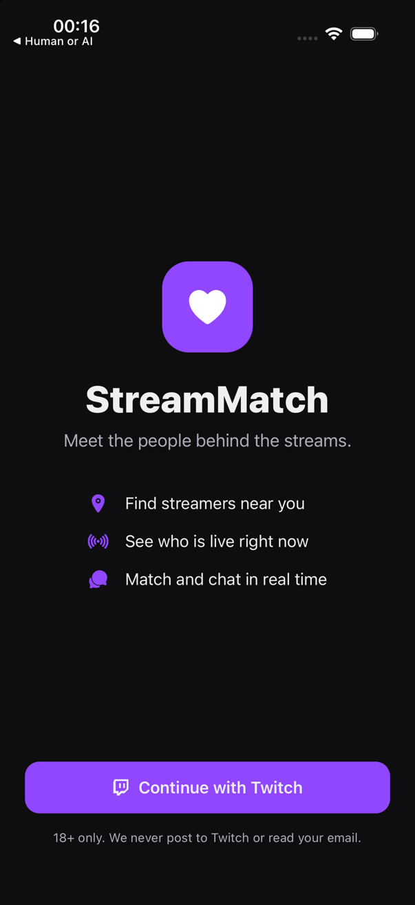 | 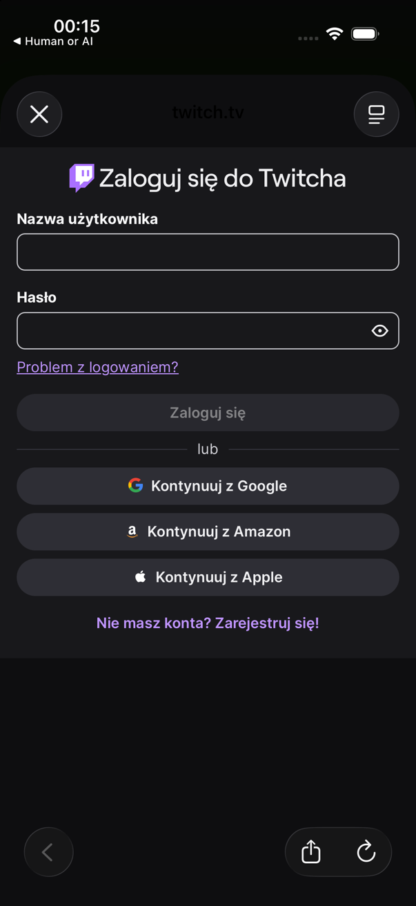 | 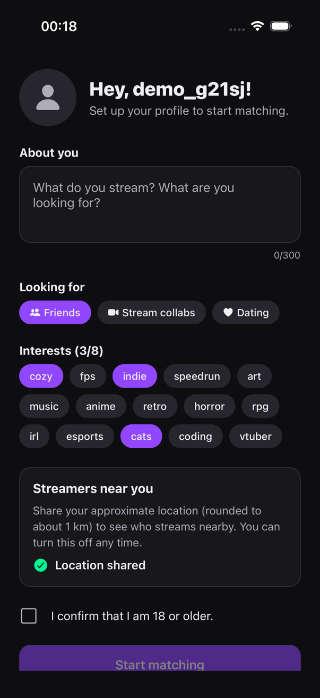 |
| `src/app/sign-in.tsx` | strona Twitcha w oknie systemowym | `src/app/onboarding.tsx` |

- **Ekran startowy** — jeden przycisk „Continue with Twitch". Gdy serwer nie ma kluczy Twitcha,
  przycisk jest wyszarzony i pojawia się komunikat.
- **Logowanie Twitch** — otwiera się w bezpiecznym oknie systemowym; aplikacja nigdy nie widzi hasła.
- **Onboarding** — bio (domyślnie pobrane z Twitcha), cel (znajomi / collaby / randki),
  do 8 zainteresowań, opcjonalne udostępnienie lokalizacji i obowiązkowe potwierdzenie 18+.

### Poznawanie ludzi

| Discover | Dopasowanie | Profil streamera |
|:-:|:-:|:-:|
| 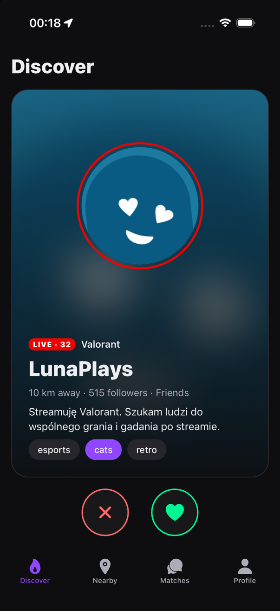 | 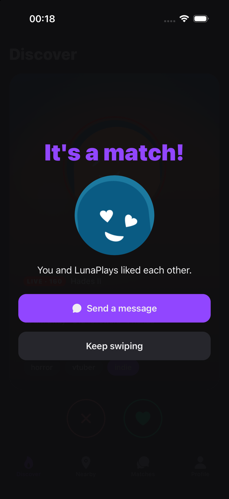 | 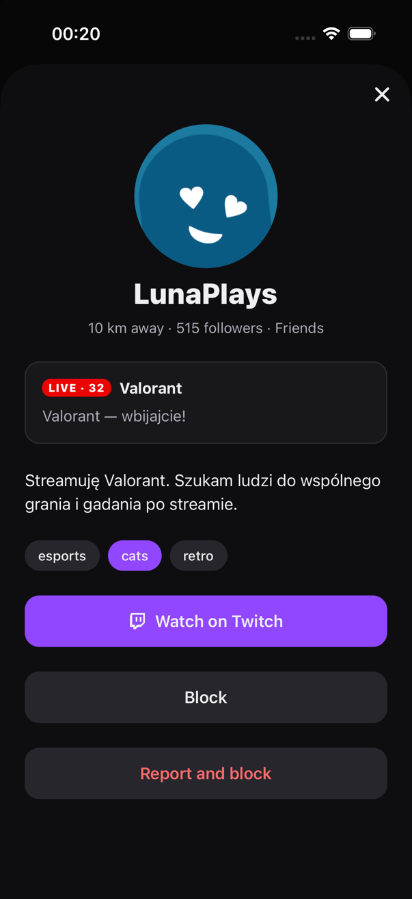 |
| `src/app/(tabs)/index.tsx` | okno w `index.tsx` | `src/app/user/[userId].tsx` |

- **Discover** — talia kart. Przesunięcie w prawo lub zielone serce = polubienie, w lewo lub
  czerwony krzyżyk = pominięcie. Kolejność: najpierw osoby na żywo, potem wspólne zainteresowania
  (podświetlone na fioletowo), potem odległość. Czerwona obwódka i plakietka `LIVE` oznaczają
  trwający stream z liczbą widzów i grą.
- **Dopasowanie** — pojawia się, gdy obie strony się polubiły. Można od razu napisać.
- **Profil streamera** — po dotknięciu karty lub wiersza listy: pełne bio, tytuł streama,
  przycisk do kanału na Twitchu, blokowanie i zgłaszanie.

### W okolicy, rozmowy, ustawienia

| Nearby | Matches | Czat | Profil |
|:-:|:-:|:-:|:-:|
| 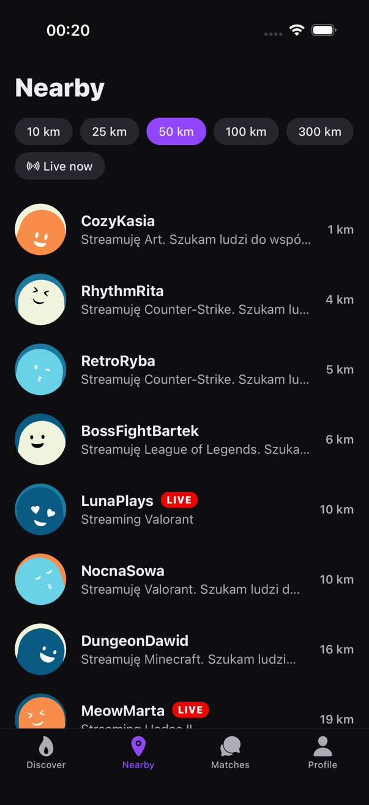 | 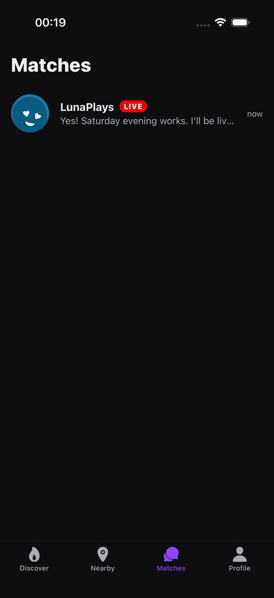 | 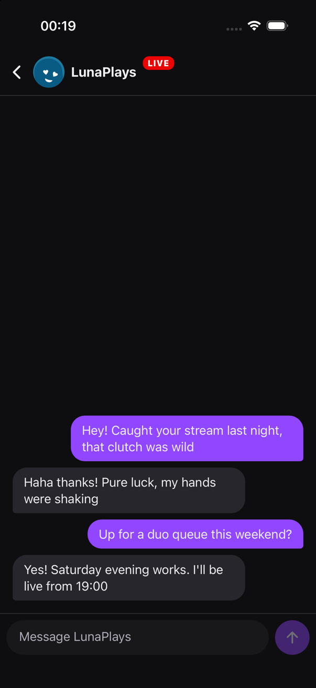 | 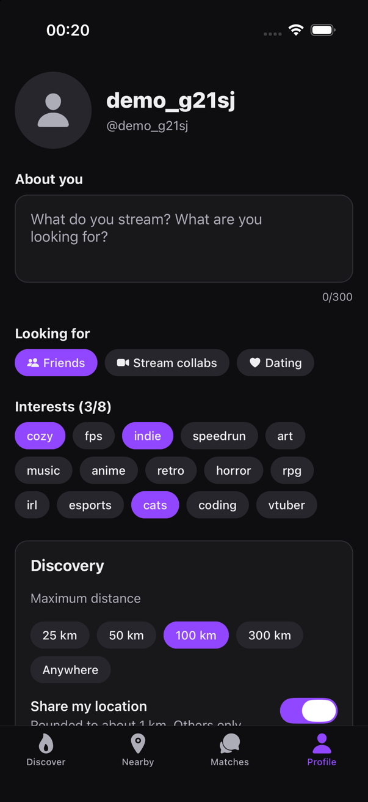 |
| `(tabs)/nearby.tsx` | `(tabs)/matches.tsx` | `chat/[matchId].tsx` | `(tabs)/profile.tsx` |

- **Nearby** — streamerzy w promieniu 10–300 km, od najbliższego, z filtrem „Live now".
  Jak to działa: [szukanie-w-okolicy.md](szukanie-w-okolicy.md).
- **Matches** — lista dopasowań z ostatnią wiadomością; nieprzeczytane są pogrubione z kropką,
  a ich liczba widnieje na ikonie zakładki.
- **Czat** — wiadomości pojawiają się natychmiast u obu stron, bez odświeżania.
- **Profil** — edycja bio, celu i zainteresowań, maksymalny dystans, przełącznik lokalizacji,
  ukrycie profilu, wylogowanie i trwałe usunięcie konta.

### Premium i reklamy

| Reklama w talii | Ekran Premium | Ekran Premium — plany |
|:-:|:-:|:-:|
| 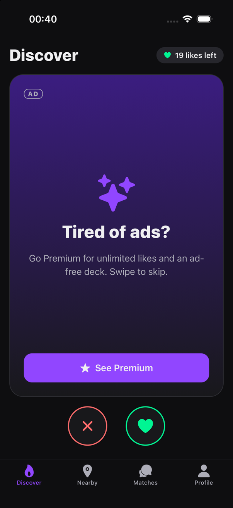 | 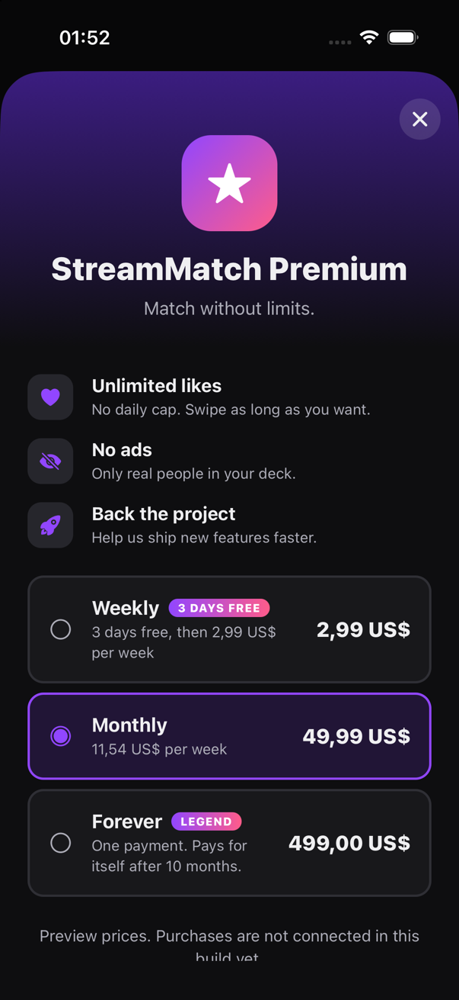 | 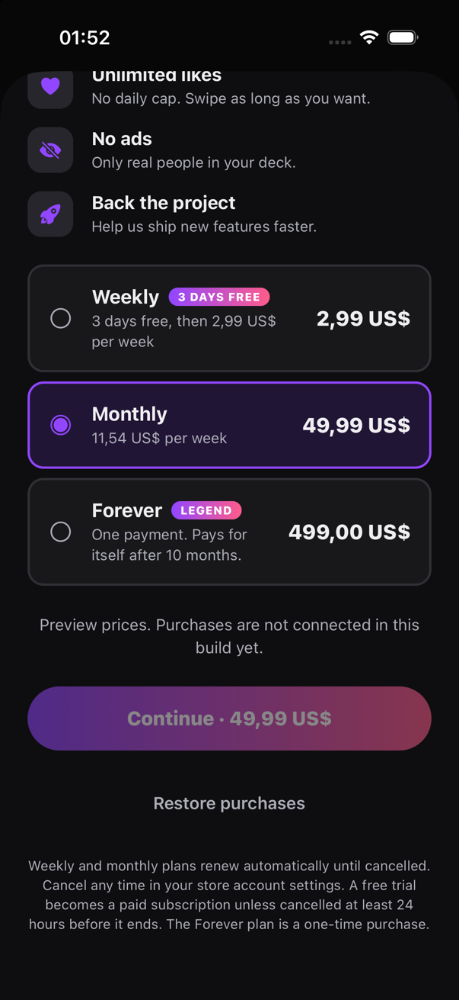 |
| `src/components/ad-card.tsx` | `src/app/paywall.tsx` | |

- **Licznik polubień** w prawym górnym rogu Discover; dotknięcie otwiera ekran Premium.
- **Reklama** zajmuje co trzecią kartę u kont darmowych. Przesuwa się ją jak profil.
- **Ekran Premium** — trzy plany: tygodniowy (z 3 dniami za darmo), miesięczny i
  „Forever" (jednorazowy). Ceny na zrzucie to podgląd; prawdziwe zawsze pochodzą ze sklepu.
- **Wyliczenia na planach** liczy aplikacja z cen ze sklepu: koszt tygodniowy każdego planu,
  „SAVE x%" względem najdroższego planu w przeliczeniu na tydzień oraz po ilu miesiącach zwraca
  się plan „Forever" w porównaniu z miesięcznym. Zmiana cen w sklepie sama zmienia te liczby.
- **Darmowy okres próbny** aplikacja odczytuje ze sklepu (oferta wprowadzająca o cenie 0) i
  pokazuje plakietkę „3 DAYS FREE" oraz przycisk „Start 3-day free trial".

## Architektura

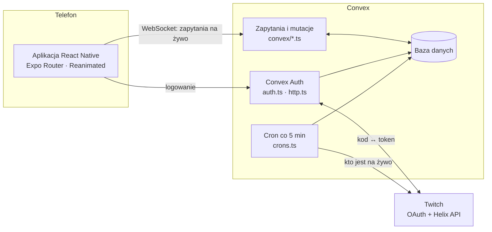

- **Aplikacja** — React Native 0.86 z natywnymi projektami `ios/` i `android/`. Biblioteki Expo
  (router, lokalizacja, obrazy, pęk kluczy) są używane jako zwykłe paczki; budowanie idzie przez
  Xcode i Gradle, bez Expo Go i EAS.
- **Convex** — jedyny serwer. Trzyma bazę, logikę i logowanie. Zapytania są „żywe": gdy dane się
  zmienią, ekran odświeża się sam (stąd czat i lista dopasowań bez odpytywania).
- **Twitch** — tożsamość użytkownika oraz publiczne dane kanału.

Nie ma Firebase ani osobnego serwera do logowania (stary endpoint na Vercelu nie jest używany).

## Logowanie przez Twitch

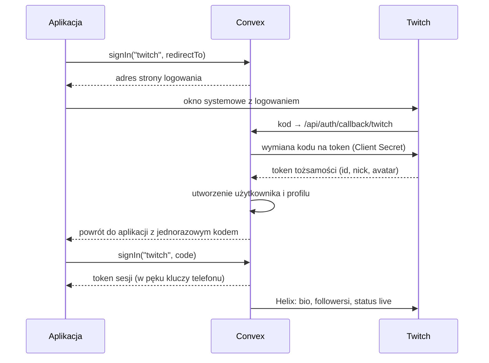

- Od Twitcha prosimy tylko o zakres `openid` — bez adresu e-mail.
- Client Secret leży wyłącznie w zmiennych środowiskowych Convex, nigdy w aplikacji.
- Bio, liczba followersów i status live są pobierane tokenem aplikacji (client credentials),
  więc tokeny użytkowników nie są nigdzie przechowywane.
- Po pierwszym logowaniu `afterUserCreatedOrUpdated` w `convex/auth.ts` tworzy profil i zleca
  `twitch.syncUser`.

## Model danych

Schemat: [`convex/schema.ts`](../convex/schema.ts).

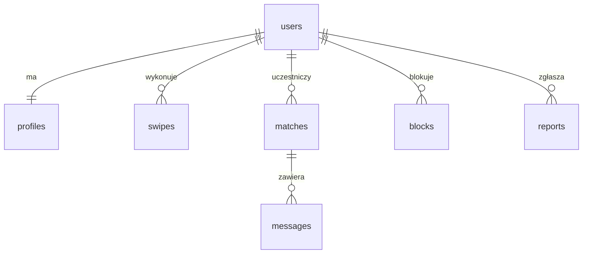

| Tabela | Co trzyma | Najważniejsze pola |
|---|---|---|
| `users` | tożsamość (Convex Auth) | `name`, `image`, `twitchId` |
| `profiles` | profil w aplikacji | `login`, `displayName`, `bio`, `tags`, `intent`, `isLive`, `gameName`, `viewerCount`, `followerCount`, `lat`, `lng`, `cell`, `maxDistanceKm`, `discoverable`, `onboarded` |
| `swipes` | polubienia i pominięcia | `fromId`, `toId`, `liked` |
| `matches` | pary, które się polubiły | `userA` < `userB`, `lastMessageText`, `lastMessageAt`, `readAtA`, `readAtB` |
| `messages` | wiadomości czatu | `matchId`, `senderId`, `body` |
| `blocks` | blokady | `blockerId`, `blockedId` |
| `reports` | zgłoszenia | `reporterId`, `reportedId`, `reason` |
| `subscriptions` | kto ma Premium | `userId`, `premiumUntil`, `productId`, `store` |
| `likeUsage` | dzienny licznik polubień | `userId`, `day`, `likes` |
| `twitchAppTokens` | pamięć podręczna tokenu aplikacji Twitcha | `accessToken`, `expiresAt` |

Do tego tabele sesji z Convex Auth (`authAccounts`, `authSessions`, `authRefreshTokens` i inne).

Para w `matches` jest zawsze zapisana w tej samej kolejności (`userA` < `userB`), więc dwie osoby
mają dokładnie jeden wiersz.

## Funkcje backendu

| Plik | Funkcja | Co robi |
|---|---|---|
| `app.ts` | `config` | które metody logowania są włączone |
| `profiles.ts` | `me`, `get` | własny profil; cudzy profil (bez współrzędnych) |
| | `update` | bio, zainteresowania, cel, dystans, widoczność, potwierdzenie 18+ |
| | `setLocation`, `clearLocation` | zapis zaokrąglonej pozycji; jej usunięcie |
| | `deleteAccount` | usuwa profil, dopasowania, wiadomości, polubienia, blokady i sesje |
| `discover.ts` | `deck` | 20 kart do przesuwania |
| | `nearby` | do 60 streamerów w zadanym promieniu |
| `swipes.ts` | `swipe` | zapisuje polubienie/pominięcie; przy wzajemności tworzy dopasowanie |
| `matches.ts` | `list`, `unreadCount`, `get` | lista rozmów, licznik nieprzeczytanych, nagłówek czatu |
| | `unmatch` | usuwa dopasowanie i rozmowę |
| `messages.ts` | `list`, `send`, `markRead` | ostatnie 100 wiadomości, wysyłka (do 1000 znaków), oznaczenie jako przeczytane |
| `safety.ts` | `block`, `report` | blokada (usuwa też dopasowanie); zgłoszenie |
| `twitch.ts` | `syncUser` | pobiera dane kanału po logowaniu |
| | `refreshLive` | cron: status live dla do 1000 ostatnio aktywnych profili |
| `billing.ts` | `status` | stan Premium i wykorzystane polubienia |
| | `refresh` | pyta RevenueCat o uprawnienie zaraz po zakupie |
| | `revenueCatWebhook` | przyjmuje zdarzenia zakupów, odnowień i wygaśnięć |
| | `grantPremium` | ręczne nadanie Premium do testów |
| `moderation.ts` | `checkMessage`, `checkBio` | automatyczna moderacja wiadomości i bio |
| `ai.ts` | `checkKey`, `decide` | test klucza OpenRouter; zapytanie do modelu Jev |
| `seed.ts` | `run`, `demoChat` | dane testowe |

Każda publiczna funkcja sprawdza zalogowanego użytkownika (`requireProfile` w `convex/lib.ts`),
a funkcje czatu dodatkowo to, czy należy on do danego dopasowania (`requireMatch`).

## Premium, limit polubień i reklamy

| | Konto darmowe | Premium |
|---|---|---|
| Polubienia | 20 dziennie (reset o północy UTC) | bez limitu |
| Pominięcia | bez limitu | bez limitu |
| Reklamy | co trzecia karta w talii | brak |
| Dopasowania i czat | bez limitu | bez limitu |

**Jak to działa**

- Limit pilnuje serwer: `spendLike()` w `convex/billing.ts` jest wołane z `swipes.swipe` i przy
  wyczerpaniu rzuca błąd `LIKE_LIMIT`. Aplikacja tylko pokazuje licznik i otwiera ekran Premium.
  Zmiana limitu: stała `FREE_DAILY_LIKES`.
- Liczy się tylko nowe polubienie; pominięcia i ponowne polubienie tej samej osoby nie.
- Reklamy wstawia aplikacja (`AD_EVERY` w `src/app/(tabs)/index.tsx`). Karta reklamowa to na razie
  własna reklama Premium — w `ad-card.tsx` można w to miejsce wstawić widok sieci reklamowej
  (np. natywną reklamę AdMob) bez zmian w logice talii.
- O tym, kto ma Premium, decyduje tabela `subscriptions` (`premiumUntil`). Zapisują do niej tylko:
  webhook RevenueCat (`/revenuecat/webhook`) oraz akcja `billing.refresh`, którą aplikacja woła
  zaraz po zakupie, żeby nie czekać na webhook. Aplikacja sama nie może sobie nadać Premium.
- Plan „Forever" nie ma daty wygaśnięcia; zwrot pieniędzy za niego (zdarzenie `CANCELLATION`)
  odbiera Premium.

**Uruchomienie płatności (RevenueCat)** — do zrobienia na Twoich kontach:

1. Załóż projekt na revenuecat.com i dodaj aplikacje iOS oraz Android
   (bundle id / package: `com.jakubjakubiak.streammatch`).
2. W App Store Connect i Google Play Console utwórz trzy produkty: subskrypcję tygodniową
   (z darmowym okresem próbnym 3 dni jako ofertą wprowadzającą), subskrypcję miesięczną oraz
   jednorazowy zakup „lifetime". Tu ustawiasz ceny, np. 2,99 / 49,99 / 499 $.
3. W RevenueCat: entitlement o identyfikatorze **`premium`**, przypięte do niego te trzy
   produkty, oraz offering „default" z pakietami Weekly, Monthly i Lifetime. Aplikacja
   rozpoznaje plany po typie pakietu (gdybyś kiedyś dodał pakiet Annual, pokaże się sam).
4. Klucze publiczne SDK wpisz do `.env.local` i przebuduj aplikację:

   ```
   EXPO_PUBLIC_REVENUECAT_IOS_KEY=appl_...
   EXPO_PUBLIC_REVENUECAT_ANDROID_KEY=goog_...
   ```

5. Na serwerze ustaw klucz tajny (do `billing.refresh`) i hasło webhooka:

   ```bash
   npx convex env set REVENUECAT_SECRET_KEY <tajny klucz API v1>
   npx convex env set REVENUECAT_WEBHOOK_AUTH <dowolny długi losowy ciąg>
   ```

6. W RevenueCat → Integrations → Webhooks: adres
   `https://<deployment>.convex.site/revenuecat/webhook`, a w polu „Authorization header" ten sam
   ciąg co w `REVENUECAT_WEBHOOK_AUTH`.

Kroki 1 i 3 można zrobić z Claude Code przez serwer MCP RevenueCat — jest wpisany w `.mcp.json`.
Przy pierwszym użyciu poprosi o zalogowanie do RevenueCat w przeglądarce (polecenie `/mcp`).

**Test bez sklepu:**

```bash
npx convex run billing:grantPremium '{"userId": "<id użytkownika>", "days": 30}'   # nadaj
npx convex run billing:grantPremium '{"userId": "<id użytkownika>", "days": 0}'    # odbierz
```

Dopóki klucze SDK nie są ustawione, ekran Premium pokazuje przykładowe ceny z dopiskiem
„Preview prices", a przycisk zakupu jest nieaktywny.

## Automatyczna moderacja

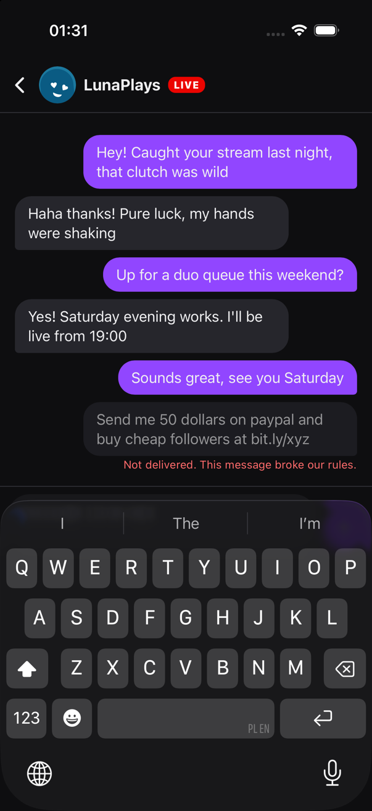

Wiadomości czatu i bio sprawdza Jev — szybki model decyzyjny TypeSafe dostępny przez OpenRouter
(`convex/moderation.ts`). Jedno sprawdzenie trwa ok. sekundy i kosztuje ok. 0,00002 $.

**Trzy reguły** (pytania tak/nie do modelu): nękanie i groźby (`abuse`), spam, reklama i prośby
o pieniądze (`scam`), oznaki niepełnoletności (`minor`). Reguła jest złamana, gdy model jest pewny
w co najmniej 85% (`BLOCK_AT`).

**Wiadomości**

1. `messages.send` zapisuje wiadomość ze statusem `pending` — widzi ją tylko nadawca.
2. Akcja `moderation.checkMessage` pyta Jev.
3. Jeśli jest w porządku: wiadomość trafia do odbiorcy, a podgląd i licznik nieprzeczytanych
   aktualizują się dopiero teraz.
4. Jeśli łamie regułę: status `blocked`. Odbiorca nigdy jej nie zobaczy, nadawca widzi ją wyszarzoną
   z dopiskiem „Not delivered", a w tabeli `reports` powstaje automatyczne zgłoszenie z powodem
   (np. `auto (message): scam 0.99`).

**Bio** — sprawdzane po zapisaniu. Bio łamiące reguły jest czyszczone, użytkownik widzi w profilu
komunikat, a zgłoszenie trafia do `reports`.

**Zasady działania**

- Moderacja włącza się sama, gdy na serwerze jest `OPENROUTER_API_KEY`. Bez klucza wiadomości
  są dostarczane od razu, jak wcześniej.
- Gdy Jev jest niedostępny, nic nie jest blokowane (lepiej przepuścić niż zatrzymać czat).
- Do modelu trafia wyłącznie treść wiadomości lub bio — bez nazw i identyfikatorów użytkowników.
- Test ręczny: `npx convex run ai:decide '{"state": "...", "questions": {...}}'`.

## Publikacja w Google Play

Google nie udostępnia własnego serwera MCP do Google Play. Istnieją tylko projekty
społeczności, które wymagają pełnego klucza konta usługi do konsoli Play — nie zostały dodane.

Publikację można zautomatyzować oficjalnym API (Android Publisher) przez Gradle Play Publisher
albo fastlane. Do tego potrzebne są rzeczy, które zakłada się ręcznie:

1. Konto dewelopera Google Play i utworzona w konsoli aplikacja `com.jakubjakubiak.streammatch`.
2. Klucz podpisujący (upload keystore) i konfiguracja podpisu wersji release w `android/app/build.gradle`.
3. Pierwszy plik `.aab` wgrany ręcznie w konsoli — API nie potrafi utworzyć pierwszego wydania.
4. Konto usługi Google Cloud z dostępem do konsoli Play i jego klucz JSON (poza repozytorium).

Po tych krokach jedno polecenie buduje i wysyła nową wersję na ścieżkę testów wewnętrznych.

## Strona WWW

Folder [`site/`](../site) — strona promocyjna w React + Tailwind CSS (Vite), niezależna od aplikacji.

- Strona główna: nagłówek ze zrzutami aplikacji, funkcje, „jak to działa", plany, FAQ.
- Podstrony wymagane przez sklepy: **Privacy Policy**, **Terms of Use** i **Delete your account**
  (Google Play wymaga publicznego adresu z instrukcją usunięcia konta).
- Rzeczy do podmiany przed publikacją są w jednym pliku, `site/src/site.ts`: adres e-mail,
  linki do sklepów (puste = „Coming soon").

```bash
cd site
npm install
npm run dev       # podgląd na http://localhost:5173
npm run build     # gotowe pliki statyczne w site/dist
```

Teksty polityki prywatności i regulaminu opisują faktyczne działanie aplikacji, ale są szkicem —
przed publikacją powinien je przejrzeć prawnik.

## Konfiguracja

Zmienne środowiskowe **Convex** (`npx convex env set NAZWA wartość`):

| Zmienna | Do czego | Skąd |
|---|---|---|
| `AUTH_TWITCH_ID` | Client ID aplikacji Twitch | dev.twitch.tv/console/apps |
| `AUTH_TWITCH_SECRET` | Client Secret | tamże, „New Secret" |
| `JWT_PRIVATE_KEY`, `JWKS` | podpisywanie tokenów sesji | `npx @convex-dev/auth` |
| `SITE_URL` | adres wersji web (powrót po logowaniu) | np. `http://localhost:8081` |
| `DEMO_LOGIN` | `true` włącza konta demo bez hasła — tylko do testów | ręcznie |
| `REVENUECAT_SECRET_KEY` | sprawdzanie zakupu zaraz po płatności | RevenueCat → API keys |
| `REVENUECAT_WEBHOOK_AUTH` | hasło webhooka RevenueCat | wymyślasz sam |
| `OPENROUTER_API_KEY` | włącza automatyczną moderację (model Jev) | openrouter.ai/keys |

Plik `.env.local` w projekcie (tworzy go `npx convex dev`, nie trafia do gita):

| Zmienna | Do czego |
|---|---|
| `CONVEX_DEPLOYMENT` | na który deployment wgrywa `npx convex dev` |
| `EXPO_PUBLIC_CONVEX_URL` | adres backendu, z którym łączy się aplikacja |
| `EXPO_PUBLIC_REVENUECAT_IOS_KEY`, `EXPO_PUBLIC_REVENUECAT_ANDROID_KEY` | publiczne klucze SDK RevenueCat (dopisujesz ręcznie) |

W konsoli Twitcha musi być wpisany adres zwrotny:

```
https://<deployment>.convex.site/api/auth/callback/twitch
```

## Budowanie i uruchamianie

Potrzebne trzy procesy: backend, Metro i natywna aplikacja.

```bash
npx convex dev      # 1. backend: wgrywa funkcje przy każdym zapisie pliku
npm start           # 2. Metro: serwuje kod JavaScript aplikacji
npm run ios         # 3. build i start na symulatorze iOS
```

**iOS w Xcode:** `cd ios && LANG=en_US.UTF-8 pod install`, potem `open ios/StreamMatch.xcworkspace` i Run.

**Android:**

```bash
export JAVA_HOME="/Applications/Android Studio.app/Contents/jbr/Contents/Home"
export ANDROID_HOME="$HOME/Library/Android/sdk"
npm run android     # albo: cd android && ./gradlew assembleDebug
```

Po zmianie `app.json` (nazwa, ikona, uprawnienia) trzeba odtworzyć projekty natywne: `npx expo prebuild`.

Kontrola jakości: `npx tsc --noEmit` i `npx expo lint`.

## Dane testowe

```bash
npx convex run seed:run '{"lat": 52.23, "lng": 21.01}'   # 20 streamerów wokół punktu
npx convex run seed:demoChat                              # przykładowa rozmowa w dopasowaniach
```

- Seed można puszczać wielokrotnie — nie dubluje profili.
- Co drugi testowy streamer „lubi" każdego prawdziwego użytkownika, więc polubienie go od razu
  daje dopasowanie. Po założeniu nowego konta uruchom seed ponownie.
- Testowe profile mają `isDemo: true` i cron statusu live ich nie rusza.

## Bezpieczeństwo i prywatność

- **Lokalizacja** jest zaokrąglana do ok. 1 km przed zapisem; inni widzą tylko dystans w km.
- **18+** — bez potwierdzenia nie da się wyjść z onboardingu.
- **Blokada** działa w obie strony: zablokowane osoby nie widzą się w talii, w Nearby ani w profilu.
- **Zgłoszenia** zapisują się w tabeli `reports` — ręczne oraz automatyczne z moderacji.
- **Usunięcie konta** (Profil → Delete account) kasuje wszystkie dane użytkownika, łącznie z rozmowami i zapisem Premium. Nie anuluje subskrypcji w sklepie — aplikacja o tym ostrzega.
- **Edycja danych** — bio, cel, zainteresowania i ustawienia zmienia się w zakładce Profil.
- **Limity treści:** bio 300 znaków, wiadomość 1000 znaków, 8 zainteresowań.

## Znane braki

- Brak przycisku „unmatch" w interfejsie (funkcja `matches.unmatch` istnieje; teraz rozmowę usuwa tylko blokada).
- Brak panelu moderatora do przeglądania zgłoszeń.
- Brak powiadomień push.
- Brak ograniczenia liczby wiadomości i polubień na minutę.
- Interfejs tylko po angielsku.
- Android: build przechodzi (także z modułem płatności), ale aplikacja nie była jeszcze uruchamiana — na tym Macu nie ma emulatora.
- Płatności: kod jest gotowy, ale zakup w sklepie nie był testowany (brak konta RevenueCat i produktów).
- Reklamy: jest miejsce na reklamę, sieć reklamowa nie jest podłączona.
- Ikona i nazwa „StreamMatch" są robocze.
